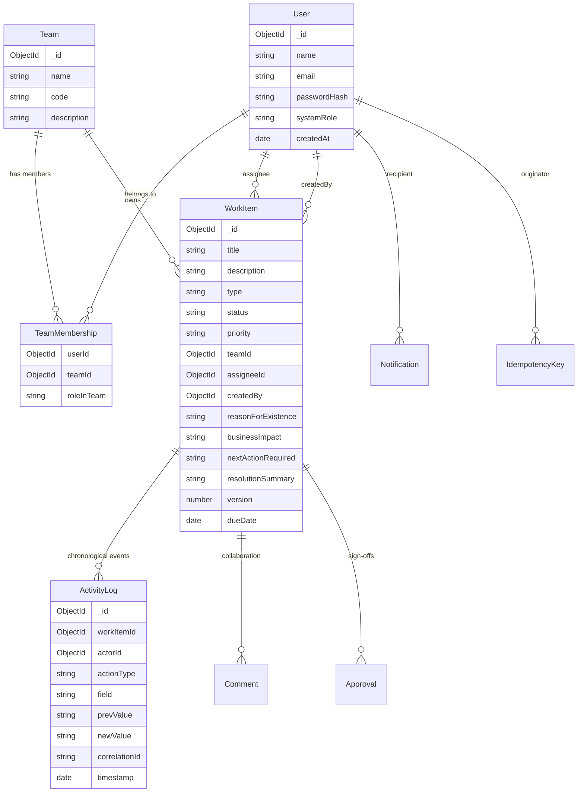
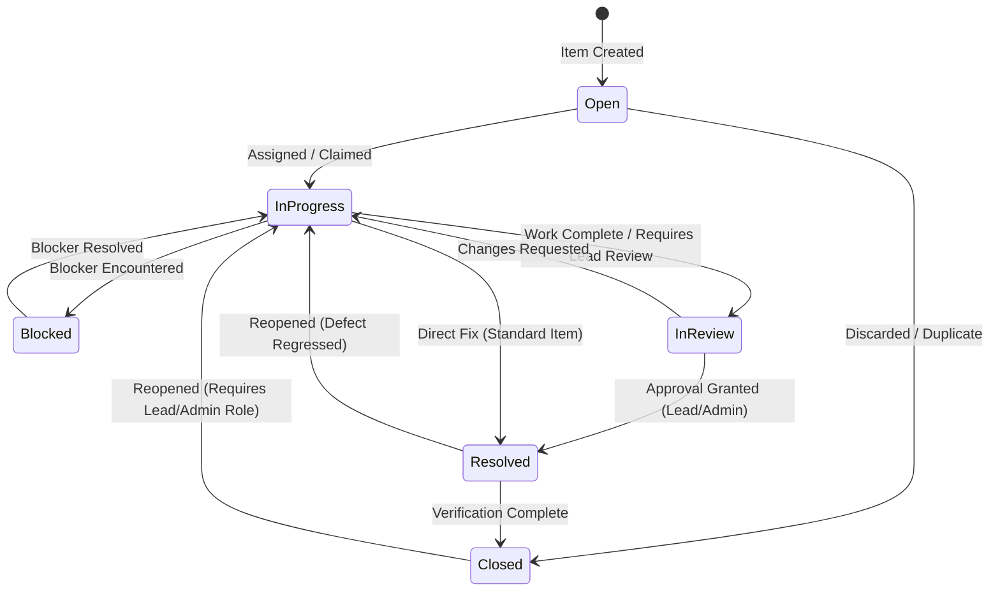
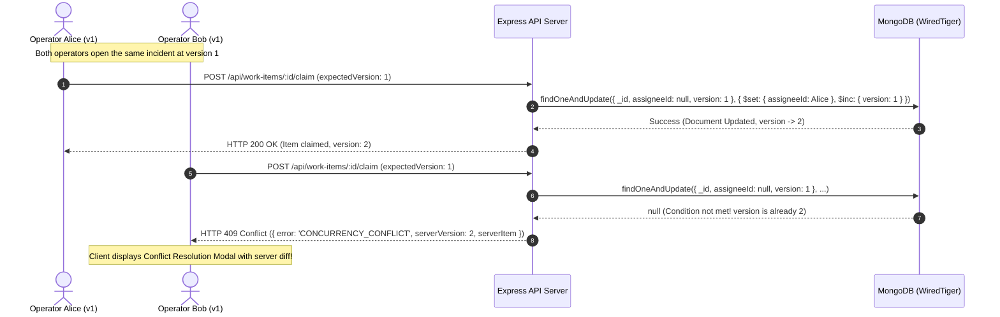

# Newtonite Operations Hub — Architecture & System Design

## 1. High-Level Architecture Diagram

```mermaid
graph TD
    Client["React.js SPA (Vite + Tailwind CSS)"] -->|HTTP / JSON (JWT, Idempotency-Key, If-Match)| API["Express.js REST API Server"]
    API --> Auth["Authentication & JWT Middleware"]
    API --> RBAC["Team & Resource-Level RBAC Middleware"]
    API --> Idem["Idempotency Cache Middleware"]
    API --> Controllers["Domain Controllers (WorkItem, Team, Approval)"]
    Controllers --> Services["Core Business Services & State Machine"]
    Services --> Mongoose["Mongoose ODM Models"]
    Mongoose --> Mongo["MongoDB Database (Replica Set / WiredTiger)"]
    Services --> Audit["Append-Only ActivityLog Engine"]
    Services --> Notif["In-App Notification Dispatcher"]
    Mongo --> Tx["Multi-Document ACID Transactions"]
```

---

## 2. Relational Entity-Relationship Diagram (Mongoose Models)



---

## 3. Workflow State Machine & Guardrails



---

## 4. Concurrent Update & Optimistic Concurrency Control Flow


